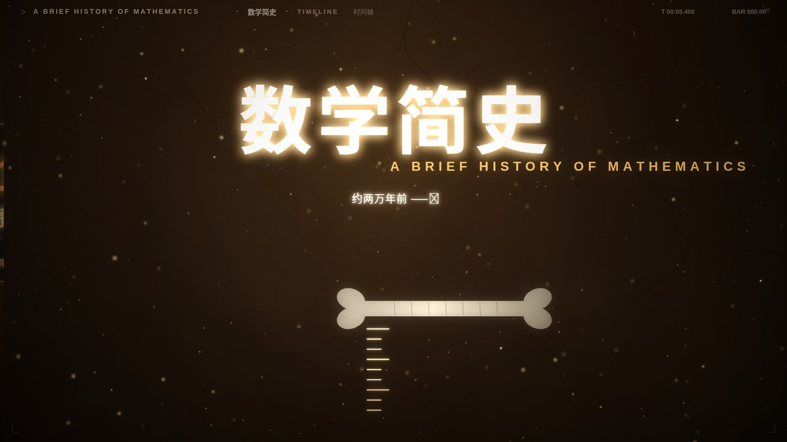
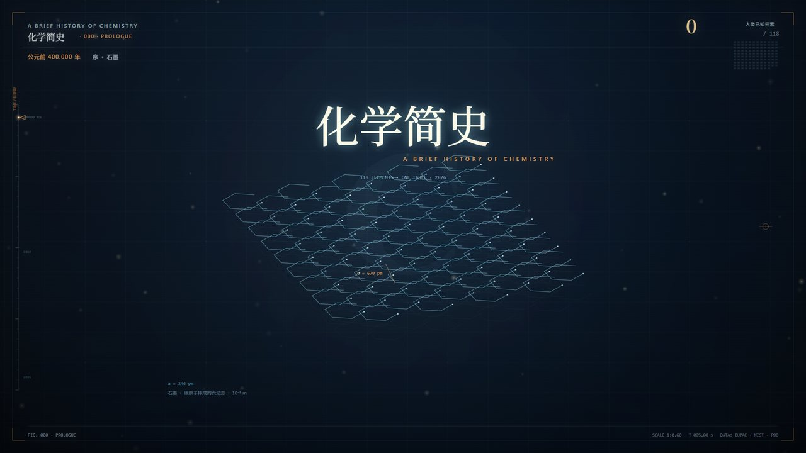
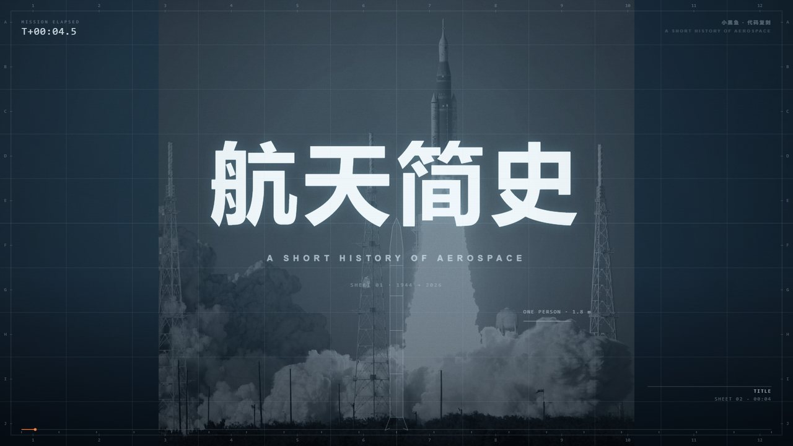
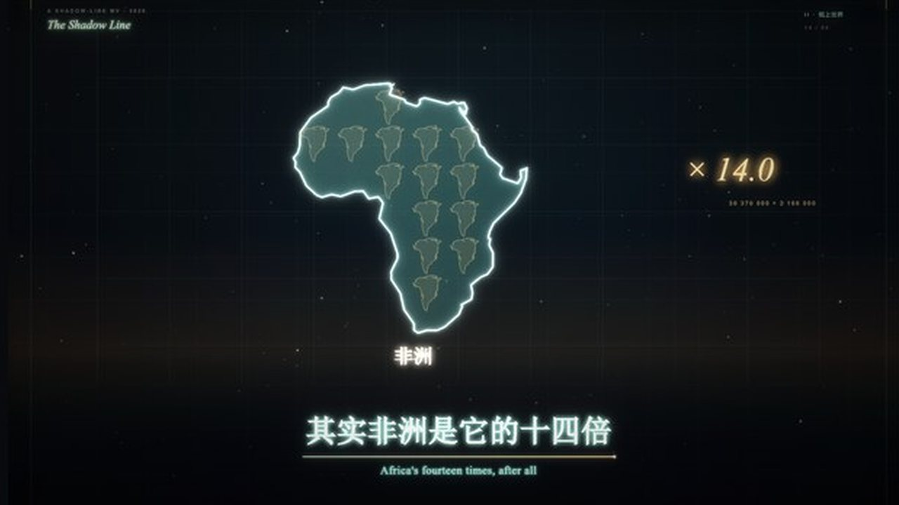
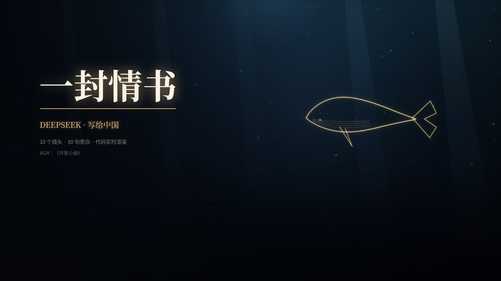

# MV渲染器 · MV Renderer

> 一套完全离线的「代码音乐视频」播放器。同一份网页资源，两个壳：**Android WebView** 与 **Windows Electron**。
> 内置 9 部作品，按「合集」整理：默认 P(doom) 置顶，另设 AI娘角色主题曲MV、科普简史、大肥鱼的情书、word excuse me 四个合集。支持五档画质、本地录制、导入自己的 MV、新建合集，播放完自动回到合集。



**版本：1.0.1** · **许可：[AGPL-3.0](LICENSE)** · 安卓包名 `com.dsha.xmmv`

仓库：<https://github.com/xunfe/mv-renderer> · 下载：[Releases](https://github.com/xunfe/mv-renderer/releases)

---

## 这是什么

MV渲染器不是视频播放器，而是一个**实时渲染器**：每一帧都由 JavaScript 在本地算出来，所以画质可以随设备调整（720P / 1080P / 2K / 4K），也可以在任意一帧暂停、录制、换音频。安卓壳用系统 WebView，PC 壳用 Electron；两边共用 `web/` 里同一套页面。

### 内置作品

首页默认 MV 固定在最上面（P(doom)），其余作品全部收进合集，合集顺序：

**AI娘角色主题曲MV → 科普简史 → 大肥鱼的情书 → word excuse me**。

| # | 作品 | 镜头 | 说明 |
|---|------|------|------|
| 01 | **世界还在写**（AI娘角色主题曲） | — | 橙子 / 小海 / 大肥鱼，全代码实时绘制，3:24，五档画质 |
| 02 | **世界还在写 · 墨海版**（模仿版） | — | 同一首歌，画面重写；人物沿用原版角色，代码开源 |
| 03 | **I'm Upping My P(doom)**（中文本地化） | 18 | 基于开源项目 pdoom-video，逐词双语歌词 |
| 04 | **数学简史 · 两万年** | 64 | 按原片真实切点逐镜重画，51 句 |
| 05 | **化学简史 · 元素之歌** | 50 | 118 种元素真实数据，31 张 Wikimedia 图片 |
| 06 | **航天简史** | 68 | 41 份素材 / 7 段实拍，原片 4K 250s |
| 07 | **地理简史 · 影子线** | 54 | Natural Earth 真海陆轮廓 + 胡焕庸线 |
| 08 | **一封情书 · DeepSeek** | 33 | 30 句原创旁白，全代码绘制 |

另有：

- **world.execute (me) ;** 官方在线版入口 / 本地离线全代码版（原曲需自备，见下文）
- **DSH PV · world.execute (me)**：PC 独有，第三方离线渲染工程（本机渲染 10–30 分钟）
- **XM 引擎演示**：2D 歌词卡点 / 3D 鼓点立柱

| 化学简史 | 航天简史 | 地理简史 | 一封情书 |
|---|---|---|---|
|  |  |  |  |

### 功能

- 同一套网页，Android / Windows 双端；断网可用
- 五档画质：720P30 / 1080P30 / 1080P60 / 2K30 / 4K60（各片支持情况不同）
- **动态分辨率**：跑不满帧时自动降低内部渲染倍率再放大，优先保证流畅（设置里可关）
- 播放页可录制，录制结果直接落到系统「下载」目录
- **合集式布局**：首页是合集卡片，点进二级页再选 MV；默认 P(doom) 置顶
- **播放完自动返回**：播放结束回到当前合集的二级页（内置 MV 与导入 MV 都支持）
- 支持导入第三方 MV（zip，Vite `--base=./` 构建产物）；可以**新建合集**并把作品 / 导入的 MV 收进去
- 首页深浅色主题、自动刷新（PC 走 SSE，安卓 2 秒轮询）
- 1.0.1 重做了启动图标与卡片图标（胶片 + 播放键）
- 《世界还在写》原版 / 墨海版都支持五档画质；4K / 2K 跑不满帧时自动降内部渲染倍率，优先保证流畅
- 合集封面标注原作者 **小伙伴ko**（B站 UID 105330745），可点击跳转

---

## 目录结构

```
web/                    共享网页资源（Android 与 PC 用的是同一套）
  home.html             首页 + 合集二级页（hash 路由）
  home.js               合集数据、导入归档、新建合集
  play.html             导入 MV 的包装播放页（负责播完返回）
  mv-return.js          内置 MV 的返回条与播完返回
  index.html            P(doom) 播放页
  mv/math/              数学简史（engine.js + scenes.js + mv.js + data/motifs + audio.m4a）
  mv/chemistry/         化学简史（118 元素数据 + 31 张 Wikimedia 图 + credits.json）
  mv/hangtian/          航天简史（41 份素材 + 7 段实拍）
  mv/shadow/            地理简史（Natural Earth 数据 + 地图绘制）
  mv/deepseek/          一封情书（引擎 + 分镜 + 表情贴纸）
  mv/world/             世界还在写（角色贴图 + 分镜 + 字体 + 长版音频）
  assets/ audio/ data/  P(doom) 的构建产物、歌词与音频
  mv-quality.js          五档画质切换（720P30 / 1080P30 / 1080P60 / 2K30 / 4K60）
  covers/ fonts/ plates/ 封面、字体（OFL）、版画素材
  engine/               引擎演示（挂到 /engine/）
  execute/              world.execute (me) 离线网页版（挂到 /execute/，AGPL-3.0）
  dshpv/  space/        PC 独有页面
pc/                     Electron 壳
  main.js preload.js server.js importer.js dshpv.js pvdetect.js
  dshpv/                DSH PV 渲染工程（含 LICENSE / LICENSES）
android/                Android 壳
  app/src/main/java/com/dsha/xmmv/   MainActivity.java / AssetServer.java
  app/src/main/res/                  图标与资源
  app/build.gradle                   compileSdk 35 / minSdk 24 / versionCode 10001
tools/                  资源准备、APK 重打包
docs/                   构建说明、素材出处
```

### 安卓端怎么跑起来的

`MainActivity` 里起一个 `AssetServer`（只监听 `127.0.0.1`），把安装包里的资源当网站根目录：

| URL | 资源 |
|---|---|
| `/` | `assets/www/index.html` |
| `/engine/...` | `assets/engine/...` |
| `/execute/...` | `assets/execute/...`（用户自选音频优先） |
| `/custom/<id>/...` | `filesDir/mv/<id>/`（导入的 MV） |
| `/__imports`、`/__delete`、`/__rec` | 导入列表 / 删除 / 录制落盘 |

大文件走流式 + Range；媒体在 APK 里必须是 STORED（不压缩），否则 Range 会退化成整包读。PC 的 `server.js` 行为与之对齐。

---

## 构建

### 安卓

需要 JDK 17 + Android SDK 35（build-tools 35）。

```bash
python3 tools/prepare_assets.py          # 把 web/ 摊进 android/app/src/main/assets
cd android
./gradlew assembleRelease               # 输出 app/build/outputs/apk/release/app-release.apk
```

签名配置写在 `android/keystore.properties`（**不要提交**）：

```properties
storeFile=/绝对路径/ks.jks
storePassword=******
keyAlias=k
keyPassword=******
```

> **覆盖安装**：1.0.1 的 `versionCode` 为 10001（`major*10000+minor*100+patch`），比 1.0.0（10000）和历史上所有 10.x 构建都大；只要签名证书不变，就能直接覆盖安装升级。
>
> 本仓库还带了一个快速重打包脚本 `tools/repack_apk.py`：在只有一个已签名基线 APK 的机器上，原位改 manifest 版本号后重新签名（v2/v3），用来出补丁包。

### Windows

```bash
cp -r web pc/web                         # main.js 里的 WEB_ROOT 就是 pc/web
cd pc
npm install                              # 只有 adm-zip 一个依赖
npx electron .                           # 开发模式
```

打包免安装版：准备一份 Electron 运行时（`resources/app` 指向 `pc/`），用任意 zip 工具整目录压缩即可。`pc/dshpv/` 需要 `pc/runtime/`（内置 Python + ffmpeg，体积大，仓库里没有）才能执行渲染，缺少时页面仍可打开、只提示运行环境缺失。

### 资源说明

`tools/prepare_assets.py` 会把 `web/` 拆成 `assets/www`（其余）、`assets/engine`、`assets/execute` 三份，和 `AssetServer` 的映射一一对应；`dshpv/`、`space/` 是 PC 独有，不打进 APK。

---

## 音频与版权（重要）

- **world.execute (me) 的原曲（`web/execute/song.flac`）不在仓库里**：它是由本仓库作者自行购买单曲后放入本地设备的，仅供个人欣赏，不随源码分发。想听请使用首页的「官方在线」入口，或自己放入合法拥有的音轨。
- 内置作品的**音乐、影像与原始创意**版权归各自原作者（详见 [NOTICE.md](NOTICE.md) 与 `web/mv/chemistry/assets/credits.json`）。随仓库分发仅为让作品可复现，**不改变**这些素材的版权归属，也不在 AGPL-3.0 的授权范围内。
- **《世界还在写》**的源码与角色素材由原作者提供，已获授权在本应用中内置展示；该作品的源码、字体与角色素材不在 AGPL-3.0 范围内，未经原作者许可请勿再分发。
- 代码（HTML / JS / CSS / Java / Node / Python）以 **AGPL-3.0** 授权；第三方组件各自保留原许可（MIT / AGPL-3.0 / OFL / CC）。

---

## 许可

Copyright (C) 2026 风铃（DSH）

本项目以 [GNU Affero General Public License v3.0](LICENSE) 发布。你可以自由使用、修改、分发；如果把它作为网络服务提供给他人，必须公开对应的完整源码。

第三方组件、字体与素材的许可见 [NOTICE.md](NOTICE.md)。

---

## 致谢

- **球球求真**（B 站 UID 7210010）：数学 / 化学 / 航天 / 地理四部曲的原作与授权
- **银铃仙兽大肥鱼**（B 站）：《一封情书》的创意参考与 BGM 授权
- **穆阿蒂布**（B 站 UID 272722241）：离线版 world.execute (me) 的渲染代码
- **mexicat**：[pdoom-video](https://github.com/mexicat/pdoom-video)
- **FrostNovaOrg**：[world-execute-web](https://github.com/FrostNovaOrg/world-execute-web)
- **MisakaZentai**：[world-execute-me-dsh-pv](https://github.com/MisakaZentai/world-execute-me-dsh-pv)
